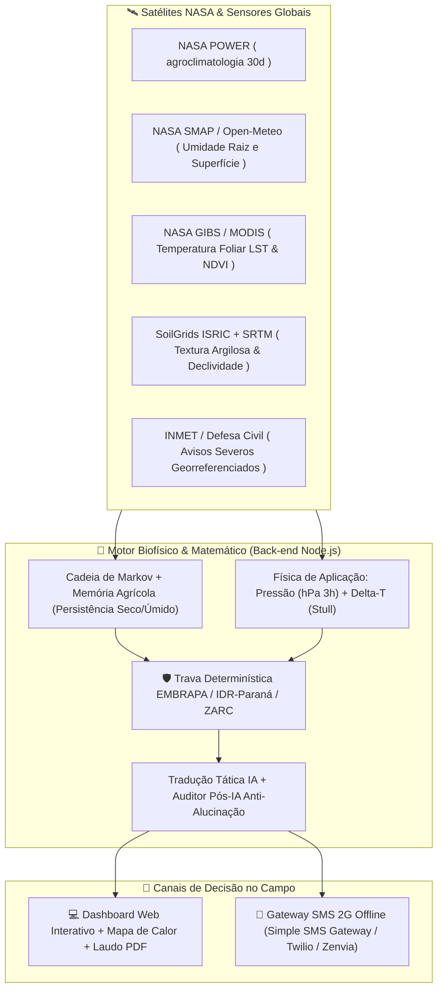

<div align="center">

# 🛡️ AgroShield
### Inteligência Orbital da NASA, Modelagem de Markov com Memória Agrícola e Decisão Auditada pela EMBRAPA via Web & SMS 2G

[](https://www.spaceappschallenge.org/)
[](https://www.embrapa.br/soja)
[](#6-comunicacao-bidirecional-via-sms-2g-sem-internet)
[](https://www.typescriptlang.org/)
[](https://nodejs.org/)

> *"No campo, o produtor rural não perde dinheiro porque faltou satélite no espaço — ele perde dinheiro quando entra com o trator no talhão na hora errada. O AgroShield leva a ciência da NASA e da EMBRAPA até onde a internet não chega."*

</div>

---

## 📌 Sumário
1. [O Problema Real no Campo](#1-o-problema-real-no-campo)
2. [A Solução AgroShield](#2-a-solução-agroshield)
3. [Arquitetura do Ecossistema](#3-arquitetura-do-ecossistema)
4. [Motor Matemático: Cadeia de Markov com Memória Agrícola](#4-motor-matemático-cadeia-de-markov-com-memória-agrícola)
5. [Dupla Trava Determinística EMBRAPA (Anti-Alucinação)](#5-dupla-trava-determinística-embrapa-anti-alucinação)
6. [Comunicação Bidirecional via SMS 2G (Sem Internet)](#6-comunicação-bidirecional-via-sms-2g-sem-internet)
7. [Camadas Orbitais, Pressão Atmosférica (hPa) e Delta-T](#7-camadas-orbitais-pressão-atmosférica-hpa-e-delta-t)
8. [Fontes de Dados e Manuais Técnicos](#8-fontes-de-dados-e-manuais-técnicos)
9. [Como Executar o Projeto Localmente](#9-como-executar-o-projeto-localmente)
10. [Suíte de Testes e Qualidade (QA)](#10-suíte-de-testes-e-qualidade-qa)
11. [Referência da API](#11-referência-da-api)

---

## 1. O Problema Real no Campo

Uma única operação agrícola realizada fora da janela ideal — como **pulverizar defensivos** antes de uma pancada de chuva ou sob vento de deriva ($> 10\text{ km/h}$), ou **entrar com maquinário pesado** em solo saturado ($> 80\%$ de umidade) — pode gerar dezenas de milhares de reais em prejuízo em poucos minutos devido a:
- **Lavagem de insumos (wash-off)** e **evaporação/deriva térmica** da calda de pulverização;
- **Compactação estrutural do solo**, erosão laminar e atolamento de tratores/pulverizadores;
- **Falta de conectividade 4G/5G** nas baixadas rurais, onde aplicativos meteorológicos pesados não carregam na cabine do trator;
- **Excesso de dados brutos sem decisão operacional:** o produtor não precisa apenas saber que *"vai chover 15 mm"*; ele precisa de um **SIM ou NÃO auditável** para a operação planejada na sua cultura (*Soja, Milho ou Trigo*).

---

## 2. A Solução AgroShield

O **AgroShield** é uma plataforma de inteligência e prevenção de danos agronômicos desenvolvida com foco na realidade produtiva de **Campo Mourão - PR** e das principais regiões agrícolas. O sistema:

1. **Delimita o talhão via satélite** (cálculo geodésico automático de área em hectares e centroide com `Turf.js`);
2. **Funde múltiplas fontes orbitais e meteorológicas em tempo real** (**NASA POWER**, **NASA SMAP**, **MODIS LST**, **SRTM**, **SoilGrids**, **INMET** e **Open-Meteo**);
3. **Simula os estados futuros da propriedade** usando **Cadeias de Markov com Memória Agrícola** e balanço hídrico;
4. **Valida cada operação (*Plantar, Pulverizar, Adubar, Colher*)** contra os limites determinísticos oficiais da **EMBRAPA Soja e IDR-Paraná**;
5. **Entrega o veredito tanto na Web (com exportação em PDF)** para o engenheiro agrônomo da cooperativa quanto por **SMS 2G puro ($\le 150$ caracteres)** diretamente no celular do produtor sem internet.

---

## 3. Arquitetura do Ecossistema



---

## 4. Motor Matemático: Cadeia de Markov com Memória Agrícola

Previsões meteorológicas tradicionais olham apenas para a média de chuva ou tratam cada dia de forma isolada. Na agricultura, porém, **a sequência importa tanto quanto o volume**:
- Chover $30\text{ mm}$ hoje sobre um solo seco recupera a lavoura;
- Chover os mesmos $30\text{ mm}$ sobre um Latossolo que já vinha recebendo água nos últimos 5 dias causa saturação hídrica, lixiviação de nitrogênio e atolamento.

Para resolver a limitação clássica das Cadeias de Markov de 1ª ordem (que olham apenas para o estado presente e esquecem o passado), o **AgroShield** implementa:
- **Matriz de Transição Hidrometeorológica (`calcularTendenciaMarkov`):** Analisa os últimos 30 dias da série **NASA POWER** no talhão para estimar as probabilidades de transição $P(\text{Úmido} \mid \text{Úmido})$ e $P(\text{Seco} \mid \text{Seco})$, identificando se o clima local está preso em um ciclo de persistência chuvosa ou abrindo uma janela firme de sol;
- **Memória Agrícola Acumulada (`atualizarMemoriaAgricola`):** Pondera o histórico recente do talhão (balanço entre precipitação acumulada, evapotranspiração $ET_0$ FAO-56, retenção argilosa do solo e escoamento superficial pelo relevo) para ajustar dinamicamente o risco do próximo estado;
- **Correlação Multivariada (`avaliarModeloBiofisicoProbabilistico`):** Cruza simultaneamente umidade radicular, temperatura de dossel, biomassa, vento e pressão atmosférica, pois no ecossistema rural cada variável amplifica o efeito das demais.

---

## 5. Dupla Trava Determinística EMBRAPA (Anti-Alucinação)

Em operações agrícolas de alto custo, **um modelo de Inteligência Artificial nunca pode decidir sozinho**. O AgroShield possui uma arquitetura de **Dupla Trava Determinística**:

1. **Piso Físico Pré-IA (`calcularPisoFisicoRegional` & `avaliarOperacaoPlanejada`):**
   - Antes de qualquer chamada ao modelo de linguagem, os dados brutos da NASA e do Open-Meteo são confrontados com os manuais regionais oficiais (**EMBRAPA Soja / IDR-Paraná** no PR, **EMBRAPA Cerrados**, **EMBRAPA Trigo**, **USDA** e **FAO**).
   - Exemplo (Paraná — Soja):
     - **Vento $\ge 10\text{ km/h}$:** bloqueia pulverização por risco de deriva;
     - **Umidade do solo $\ge 80\%$:** bloqueia tráfego de máquinas por compactação/atolamento;
     - **Delta-T $> 8\,^\circ\text{C}$ ou $< 2\,^\circ\text{C}$:** alerta para evaporação da gota no ar ou escorrimento foliar.
2. **Auditoria Pós-IA (`auditarEFormatarParaFrontEnd` & `auditarSms2GContraFisica`):**
   - Verifica se o texto gerado pela IA inventou algum número inexistente na telemetria (`contemNumeroAlucinado`) ou se contradisse o veredito físico;
   - Caso a API de IA esteja offline ou sem cota, o card **Parecer Direto do Manual Oficial (Sem Depender da IA)** garante funcionamento **100% determinístico e ininterrupto**.

---

## 6. Comunicação Bidirecional via SMS 2G (Sem Internet)

Para atender produtores em zonas de sombra de conectividade (onde pacotes de dados 3G/4G não funcionam, mas o canal de sinalização GSM/2G alcança), o AgroShield conta com um módulo completo de **SMS 2G Offline**:

- **Disparo Ativo pelo Celular Local (`Simple SMS Gateway`):** Integração nativa via HTTP local (`SIMPLE_SMS_GATEWAY_URL`) com aparelho Android na rede local, disparando SMS reais pela operadora móvel a custo zero;
- **Integração Cloud (`Twilio` / `Zenvia`):** Suporte a envio e webhook bidirecional (`/api/sms-responder`) com validação criptográfica `HMAC-SHA1` (`X-Twilio-Signature`) e escape seguro de XML TwiML;
- **Compactação Inteligente ($\le 150$ caracteres):** Respostas diretas começando com `AGROSHIELD: SIM` ou `AGROSHIELD: NAO`, informando chuva, vento e a diretriz oficial da EMBRAPA sem depender de internet no celular do produtor.

---

## 7. Camadas Orbitais, Pressão Atmosférica (hPa) e Delta-T

No mapa interativo e no painel lateral, o agrônomo ou produtor visualiza:

| Funcionalidade | Descrição Técnica | Impacto na Prevenção de Danos |
| :--- | :--- | :--- |
| **Mapa de Calor de Chuva Regional** | Malha de 5 pontos cardeais (**Centro, Norte, Sul, Leste, Oeste** a $\sim 12\text{ km}$ do talhão) | Mostra visualmente de qual direção a frente de chuva está se aproximando da fazenda |
| **Pressão Atmosférica ($\text{hPa}$)** | Monitoramento da pressão ao nível da superfície e variação em 3 horas ($\Delta P_{3\text{h}}$) | Quedas bruscas ($\le -2,5\text{ a }-4,0\text{ hPa}$) antecipam tempestades antes da primeira gota cair |
| **Delta-T de Pulverização ($^\circ\text{C}$)** | Depressão psicrométrica calculada pela equação de bulbo úmido de **Stull (2011)** | Evita aplicação quando a gota evaporaria no ar ($\Delta T > 8\,^\circ\text{C}$) ou escorreria da folha ($\Delta T < 2\,^\circ\text{C}$) |
| **Camadas NASA (SMAP / MODIS)** | Alternância em 1 clique entre *Alerta*, *Chuva hoje*, *Umidade do solo*, *Calor do dossel* e *Cobertura* | Identifica estresse hídrico na zona radicular e estresse térmico foliar |
| **Stress Test Climático** | Simulação instantânea de *El Niño*, *La Niña*, *Seca Extrema*, *Tempestade Severa* e *Geada* | Permite testar a resiliência operacional da safra sob eventos extremos |
| **Exportação de Laudo em PDF** | Geração de relatório técnico formatado direto pelo navegador | Documentação auditável para cooperativas agrícolas, crédito e seguro rural |

---

## 8. Fontes de Dados e Manuais Técnicos

- **NASA POWER API (`power.larc.nasa.gov`):** Precipitação histórica/recente (`PRECTOTCORR`), umidade superficial e radiação (`ALLSKY_SFC_SW_DWN`), vento a 2m (`WS2M`) e temperatura (`T2M`).
- **NASA SMAP & Open-Meteo Soil Moisture:** Umidade volumétrica do solo em superfície ($0\text{–}7\text{ cm}$) e zona radicular ($7\text{–}28\text{ cm}$).
- **NASA GIBS / MODIS Terra:** Temperatura de superfície terrestre / dossel (`MODIS_Terra_Land_Surface_Temp_Day`) e vigor vegetativo (`NDVI`).
- **ISRIC SoilGrids 250m & NASA SRTM:** Textura de solo (argila, areia, silte, pH e carbono orgânico) e altimetria/declividade do terreno.
- **RainViewer Weather Radar API:** Tiles de refletividade de radar meteorológico em tempo real sobre o mapa de satélite Esri World Imagery.
- **INMET / Defesa Civil:** Polígonos oficiais de avisos meteorológicos severos cruzados via `turf.booleanPointInPolygon`.
- **Manuais Agronômicos Integrados:** EMBRAPA Soja, IDR-Paraná, ZARC (MAPA), EMBRAPA Trigo, EMBRAPA Cerrados, USDA Extension e FAO Irrigation & Drainage Paper 56.

---

## 9. Como Executar o Projeto Localmente

### Pré-requisitos
- **Node.js** `>= 20.x` e **npm**

### 1. Instalar dependências
```bash
npm install
npm --prefix backend install
```

### 2. Configurar variáveis de ambiente (Opcional para SMS Real / IA)
No arquivo `backend/.env` (e `.env` na raiz):
```env
PORT=3000
FARMER_DEFAULT_PHONE=+5544999874707
SIMPLE_SMS_GATEWAY_URL=http://172.17.167.104:8080/send-sms
TWILIO_ACCOUNT_SID=seu_sid_opcional
TWILIO_AUTH_TOKEN=seu_token_opcional
TWILIO_PHONE_NUMBER=+17372508034
```
*(O sistema funciona 100% mesmo sem chaves externas graças ao motor determinístico da EMBRAPA e à persistência com fallback automático em memória).*

### 3. Iniciar o Back-end e o Front-end
Em dois terminais separados:

```bash
# Terminal 1 — Back-end (Porta 3000)
npm run backend
```

```bash
# Terminal 2 — Front-end Vite (Porta 8080)
npm run dev
```

Acesse no navegador: **http://localhost:8080**

---

## 10. Suíte de Testes e Qualidade (QA)

O projeto conta com **49 testes automatizados** cobrindo cálculos geodésicos, contratos de API, camadas espaciais, travas anti-alucinação, física de Markov/Delta-T e webhooks de SMS 2G:

```bash
# Executar testes unitários do Front-end (Vitest — 20 testes)
npm test

# Executar bateria completa de QA do Back-end (29 testes determinísticos e HTTP)
npm run test:backend

# Checagem estrita de tipos TypeScript e build de produção
npx tsc --noEmit
npm run build
```

---

## 11. Referência da API

| Método | Rota | Descrição |
| :--- | :--- | :--- |
| `POST` | `/api/analyze-field` | Recebe o polígono do talhão, cultura, operação planejada, data e cenário climático; retorna o laudo completo NASA + EMBRAPA, `operationPlan`, `biophysModel`, `rainHeatmapGrid`, `pressureHpa`, `deltaT` e disparo de `smsAlert`. |
| `POST` | `/api/sms-responder` | Webhook bidirecional de SMS 2G (compatível com TwiML XML, JSON e Simple SMS Gateway). Recebe a pergunta do produtor em linguagem natural e responde em $\le 150$ caracteres auditados pela física. |
| `GET` | `/api/history` | Retorna o histórico de análises salvas (PostgreSQL `JSONB` ou fallback em memória) e os logs de auditoria de SMS 2G. |
| `GET` | `/health` | Diagnóstico de saúde do servidor e status da conexão com o banco de dados. |

---

<div align="center">
  <sub>Desenvolvido para o <b>NASA Space Apps Challenge 2026 · Field Shift</b> — Campo Mourão, PR, Brasil 🌱🚜</sub>
</div>
